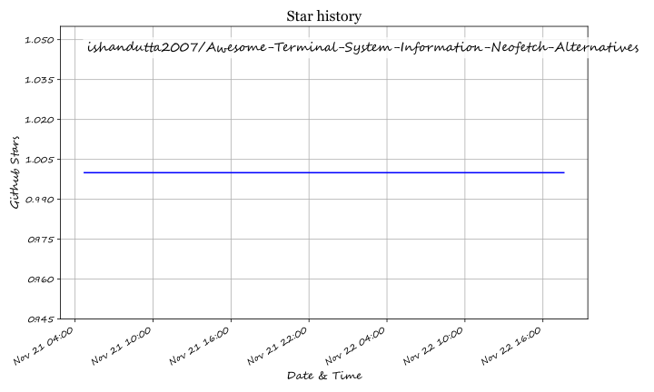

# 🖥️ Awesome-Terminal-System-Information-Neofetch-Alternatives

 

### ⚡ Top Terminal System Information & Neofetch Alternatives Ecosystem 🚀

**A Curated Directory of CLI System Fetchers, Hardware Diagnostics, Process Tracers, and Sensor Telemetry Tools**  

*Explore high-performance CLI utilities, cross-platform hardware monitors, and modern system introspection tools across Linux, macOS, Windows, BSD, and Android.*

---

## 📑 Table of Contents

- [🌐 Sector Overview & Market Dynamics](#-sector-overview--market-dynamics)
- [🏢 SaaS & Hosted Platforms](#-saas--hosted-platforms)
- [💻 Open-Source GitHub Projects](#-open-source-github-projects)
  - [⭐ Featured Open-Source Projects](#-featured-open-source-projects)
  - [🔧 Specialized & Additional Open-Source Options](#-specialized--additional-open-source-options)
- [🤝 How to Contribute](#-how-to-contribute)
- [💖 Support & Sponsorship](#-support--sponsorship)
- [⚠️ Disclaimer](#️-disclaimer)
- [📈 Star History](#-star-history)

---

## 🌐 Sector Overview & Market Dynamics

The computer hardware diagnostic, terminal system information, and telemetry sector forms a vital niche of the broader IT Infrastructure & Observability Tools market, with dedicated hardware monitoring software valued at approximately **$2.7B – $5.9B** and overall IT monitoring eclipsing **$25B+** globally. The market is **moderately fragmented** between enterprise cyber-safety conglomerates (such as Gen Digital) delivering bundled desktop utilities, independent hardware diagnostics software houses (CPUID, REALiX, FinalWire) serving passionate power users, and a hyper-collaborative, community-driven open-source ecosystem that dominates command-line ricing, desktop screenshots, and server terminal introspection.

---

## 🏢 SaaS & Hosted Platforms

*Below is the breakdown of notable commercial and hosted platforms with online validators, cloud telemetry, or proprietary monitoring engines, ranked by parent company size / estimated revenue (descending).*

| Platform | Company Size / Valuation & Revenue | Description | Pricing | Free Tier Limit |
| --- | --- | --- | --- | --- |
| **[Speccy](https://www.ccleaner.com/speccy)** | **~$5.0B – $5.2B ARR** (Parent: Gen Digital Inc., NASDAQ: GEN, Fortune 500, ~3,500+ employees) | Proprietary system information tool by Piriform/CCleaner offering detailed hardware summaries, live temperatures, and shareable web/XML diagnostic snapshots. | Starting at $19.95/year (Speccy Professional; Free version available) | Free forever (home personal use; full hardware summary and real-time temperatures without automatic updates or premium support) |
| **[HWMonitor & HWMonitor PRO](https://cpuid.com)** | **~$2.0M ARR** (Developer: CPUID, boutique private firm in France, ~10–15 employees) | Hardware health monitoring software that tracks voltages, temperatures, and fan speeds with remote network and cloud monitoring capabilities in the PRO tier. | Starting at €19.95 (HWMonitor PRO Standard license; Extended at €34.95) | Free forever (standard HWMonitor covers local system monitoring; PRO offers a 30-day evaluation trial with remote connection limits) |
| **[CPU-Z (CPUID & Online Validator)](https://www.cpuid.com/softwares/cpu-z.html)** | **~$2.0M ARR** (Developer: CPUID, boutique private firm in France, ~10–15 employees) | Proprietary hardware profiling utility with cloud validation (CPU-Z Validator) for sharing and verifying CPU, motherboard, and RAM benchmarks online. | Free ($0 for standard Windows/Android app; optional in-app ad removal ~$0.49–$1.60) | Free forever (full hardware detection, reporting, and unlimited web benchmark validation submissions) |
| **[HWiNFO](https://www.hwinfo.com/)** | **~$1.0M – $2.0M ARR (Est.)** (Developer: REALiX s.r.o., private independent company in Slovakia, ~5–10 team members) | Comprehensive proprietary hardware analysis, real-time sensor monitoring, and remote/cloud reporting tool for Windows and DOS. | Starting at $29.00 (Pro Personal Lifetime license; Business at $44.00) | Free forever (non-commercial personal use only; sensor logging and shared memory/REST API limited to 12-hour run intervals) |
| **[AIDA64](https://aida64.com)** | **~$850K – $1.0M ARR** (Developer: FinalWire Ltd., private boutique developer in Hungary, ~3–5 team members) | Commercial system diagnostics, stress-testing, and network audit suite with remote web dashboards and cloud telemetry integrations. | Starting at $65.95 (AIDA64 Extreme 1-year license for up to 3 PCs) | 30-day free trial (trial limits certain sensor readings, benchmark results, and hardware details) |

---

## 💻 Open-Source GitHub Projects

*Active community-driven terminal system fetchers, CLI hardware profilers, TUI monitors, and diagnostic tools, ranked strictly by GitHub_Stars_Count (descending).*

### ⭐ Featured Open-Source Projects

- **[btop](https://github.com/aristocratos/btop)**   
  A modern, high-performance terminal resource monitor written in C++ with responsive graphs for CPU, memory, disks, network, and processes.

- **[Fastfetch](https://github.com/fastfetch-cli/fastfetch)**   
  An actively maintained, lightning-fast, and highly customizable Neofetch replacement written in C with JSONC configuration, logo backends, and multi-platform support (Linux, macOS, Windows, BSD, Android).

- **[neofetch](https://github.com/dylanaraps/neofetch)**   
  The legendary CLI system information tool written in Bash 3.2+ that defined the entire terminal fetch genre (archived, reference implementation).

- **[pranshuparmar/witr](https://github.com/pranshuparmar/witr)**   
  Modern CLI and TUI introspection tool ("Why is this running?") written in Go that traces any process, port, container, or file back to its parent service or supervisor.

- **[bottom](https://github.com/ClementTsang/bottom)**   
  A cross-platform graphical process and system monitor for the terminal written in Rust, featuring customizable widgets, zoomable time scales, and minimal overhead.

- **[onefetch](https://github.com/o2sh/onefetch)**   
  Command-line Git repository information tool written in Rust that displays project summary, languages, commit lineage, and code statistics alongside ASCII art.

- **[bpytop](https://github.com/aristocratos/bpytop)**   
  Linux/macOS/FreeBSD resource monitor written in Python featuring game-inspired UI, CPU temperatures, disks, processes, and network graphs.

- **[LibreHardwareMonitor](https://github.com/LibreHardwareMonitor/LibreHardwareMonitor)**   
  Open-source fork of Open Hardware Monitor providing deep Windows hardware sensor telemetry (voltages, fan RPM, GPU/CPU thermals, clock rates) and an integrated web server.

- **[screenFetch](https://github.com/KittyKatt/screenFetch)**   
  The classic Bash screenshot information tool that automatically detects Linux distributions and displays ASCII art logos alongside hardware and desktop statistics.

- **[CPU-X](https://github.com/TheTumultuousUnicornOfDarkness/CPU-X)**   
  Free and open-source system profiler and hardware monitoring utility for GNU/Linux and FreeBSD (similar to CPU-Z) offering GTK GUI and NCurses TUI modes.

- **[cpufetch](https://github.com/Dr-Noob/cpufetch)**   
  Simple yet detailed CLI architecture fetcher written in C that parses CPU microarchitecture, peak frequencies, cache layouts, and vendor ASCII logos.

- **[pfetch](https://github.com/dylanaraps/pfetch)**   
  Lightweight, POSIX-compliant shell script system information tool designed for speed, portability, and minimal dependencies across Unix-like systems.

- **[HyFetch](https://github.com/hykilpikonna/hyfetch)**   
  Actively maintained Neofetch successor featuring LGBTQ+ pride flag color palettes, up-to-date distro detection, and a built-in `neowofetch` command.

- **[Macchina](https://github.com/Macchina-CLI/macchina)**   
  Fast, minimal, and customizable system information fetcher written in Rust with low execution overhead and themeable layouts.

- **[Winfetch](https://github.com/kiedtl/winfetch)**   
  Native PowerShell system information utility inspired by Neofetch, specifically tailored for Windows 10/11 and Windows Server terminals.

- **[inxi](https://github.com/smxi/inxi)**   
  Full-featured CLI system information script widely used in tech forums and IRC support channels for comprehensive hardware and kernel debugging.

- **[Hardinfo2](https://github.com/hardinfo2/hardinfo2)**   
  Modern GTK-based Linux system profiler and hardware benchmark utility offering deep PCI/USB device breakdown, sensors, and stress testing.

- **[NerdFetch](https://github.com/ThatOneCalculator/NerdFetch)**   
  POSIX `sh` fetch script using compact Nerd Fonts glyphs and icons rather than large multi-line ASCII art banners.

- **[Archey4](https://github.com/HorlogeSkynet/archey4)**   
  Maintained Python-based system information tool inspired by the original Archey script for modern Linux distributions and macOS terminals.

- **[afetch](https://github.com/13-CF/afetch)**   
  Simple, multithreaded, and ultra-fast system information fetcher written in C99 for terminal minimalists.

- **[gpufetch](https://github.com/Dr-Noob/gpufetch)**   
  Companion CLI tool to cpufetch focused specifically on GPU specifications, compute capabilities, VRAM, and GPU architecture.

- **[ufetch](https://github.com/jschx/ufetch)**   
  Tiny, single-file shell scripts tailored specifically for individual Unix distributions (Arch, Debian, Void, Alpine, FreeBSD, etc.).

- **[paleofetch](https://github.com/ss7m/paleofetch)**   
  Extremely fast Neofetch alternative written in C conforming to the suckless philosophy (configured via header file and recompiled).

- **[ramfetch](https://github.com/WhoseTheNerd/ramfetch)**   
  Dedicated CLI utility written in shell that parses `/proc/meminfo` to display memory usage, swap allocations, and module specifications.

---

### 🔧 Specialized & Additional Open-Source Options

Looking to build a complete custom diagnostics cockpit? Combine these modular tools:
* ⚡ **Fastfetch** or **pfetch** for instantaneous login banner generation.
* 🔍 **witr** for interactive TUI drill-downs into rogue listening ports and runaway background services.
* 📊 **btop** or **bottom** for live terminal CPU core temperatures, fan RPM, and GPU VRAM usage.
* 🌐 **Prometheus Node Exporter** + **Grafana** for remote cluster telemetry dashboards.

---

## 🤝 How to Contribute

Contributions are warmly welcomed! Help keep this ecosystem up-to-date and comprehensive:

1. 🍴 **Fork** this repository.
2. 🌿 **Create a branch** for your update (`git checkout -b feature/add-new-fetcher`).
3. 📝 **Add/edit entries** in `README.md` following the existing format:
   - Provide the project name, official URL, Stars_Count badge, and a concise 1–2 sentence description.
   - For SaaS tools, specify company size/revenue, starting pricing tier, and free trial / forever limits.
4. ✅ **Ensure accuracy** by linking directly to official documentation or repositories.
5. 🚀 **Submit a Pull Request** with a brief summary of why the utility should be featured.

---

## 💖 Support & Sponsorship

If this curated list saved you time, enhanced your terminal setup, or helped you discover great system telemetry tools, please consider supporting the project:

- ⭐ **Star this repository** to improve discoverability for other developers.
- 🍴 **Fork and share** it with your developer and DevOps communities.
- ☕ **Buy me a coffee**: Sponsor ongoing open-source maintenance via the [GitHub Sponsors Dashboard](https://github.com/sponsors/ishandutta2007).

Your support keeps these curated awesome lists maintained, accurate, and up-to-date! 🙌

---

## ⚠️ Disclaimer

- This is a **community-curated** list — not exhaustive and not an official commercial endorsement.
- Hardware monitoring and low-level sensor tools may require elevated privileges (`sudo` on Unix or Run as Administrator on Windows) to read kernel drivers, MSRs, or SMBus registers.
- Always review terminal outputs before sharing screenshots publicly to avoid unintentionally disclosing private hostnames, internal IP addresses, serial numbers, or sensitive credentials.

---

## 📈 Star History

## Star History

<a href="https://star-history.com/#ishandutta2007/Awesome-Terminal-System-Information-Neofetch-Alternatives&Timeline" align="center">
  <picture>
    <source media="(prefers-color-scheme: dark)" srcset="assets/ishandutta2007_Awesome-Terminal-System-Information-Neofetch-Alternatives_growth.svg">
    
  </picture>
</a>
